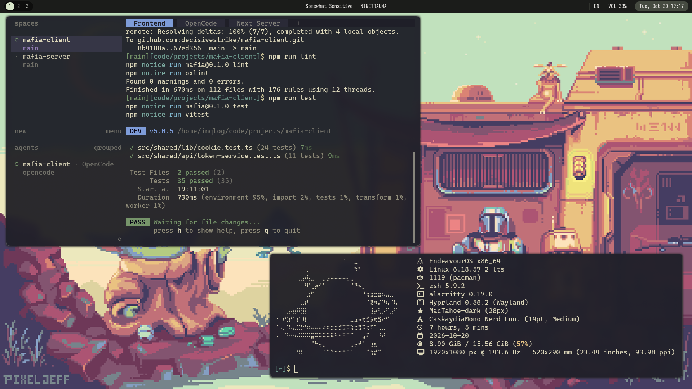

# My Dotfiles

<div align="center">


<b>My beautiful Kanagawa-themed Hyprland setup</b>

</div>



## Installation

1. Clone the repository:

```bash
    git clone https://github.com/decisivestrike/dotfiles.git .dotfiles
    cd .dotfiles
```

2. Use stow to create simlinks:

```bash
    stow .
```

## Review

### Shell

zsh

based on https://github.com/radleylewis/zsh

| Key      | Action                                              |
| -------- | --------------------------------------------------- |
| `Ctrl+R` | Fuzzy history search (fzf)                          |
| `Ctrl+T` | Fuzzy file search including hidden files (fzf + fd) |
| `Ctrl+F` | Fuzzy file search excluding hidden files (fzf + fd) |
| `Ctrl+→` | Move forward one word                               |
| `Ctrl+←` | Move backward one word                              |
